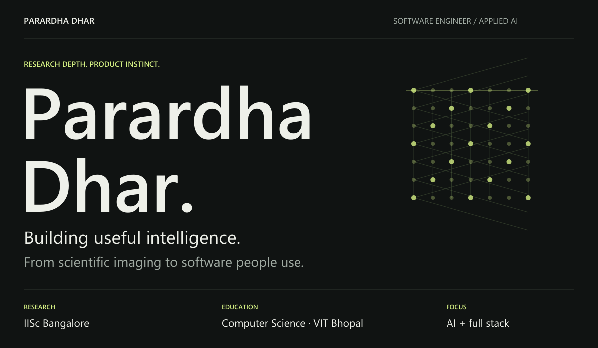
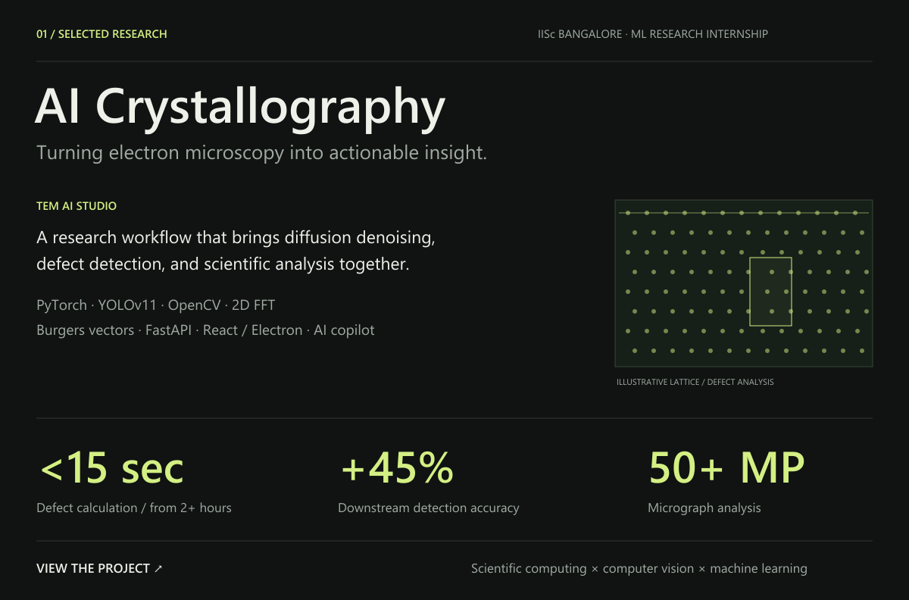
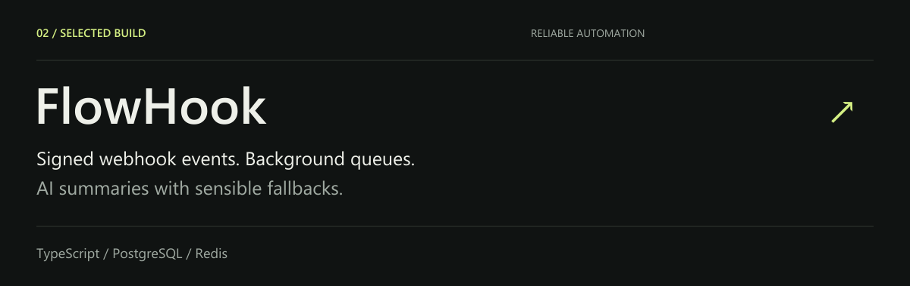
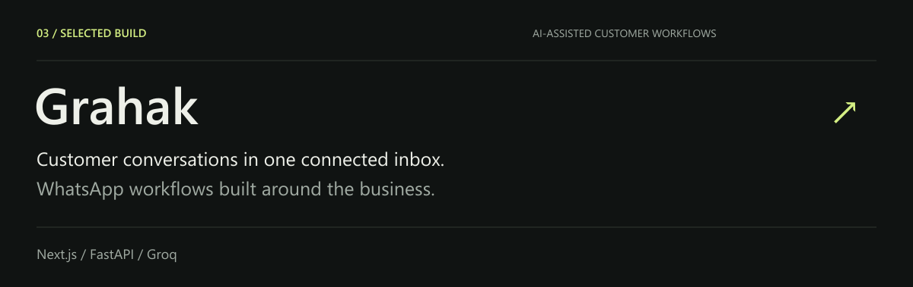
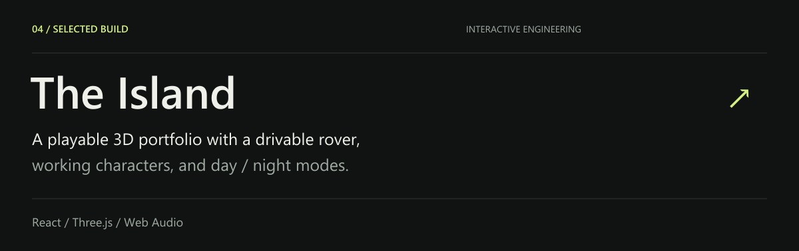
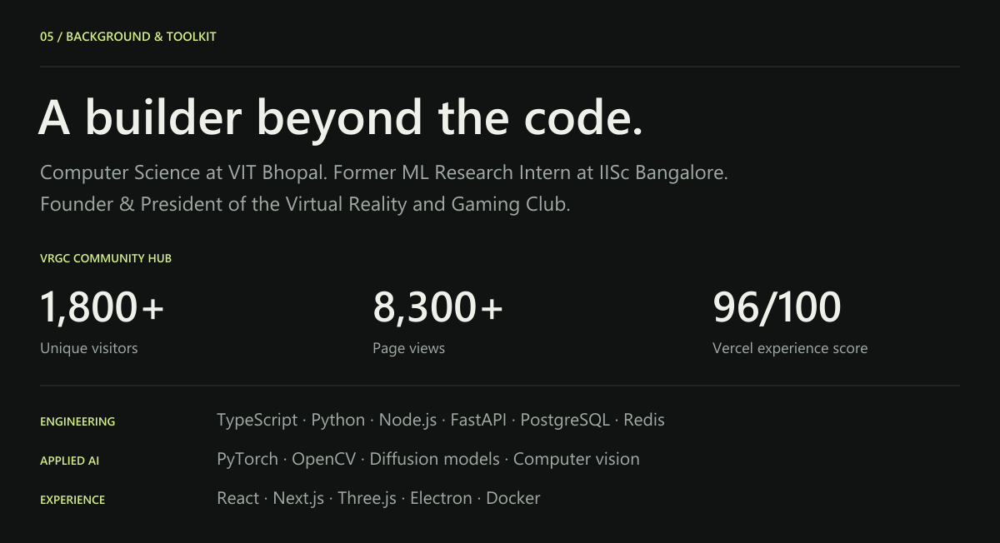
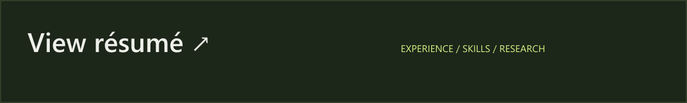

<a href="https://parardha.vercel.app">Portfolio ↗</a> &nbsp; · &nbsp; <a href="https://www.linkedin.com/in/parardhadhar">LinkedIn ↗</a> &nbsp; · &nbsp; <a href="mailto:parardhadhar@gmail.com">Email ↗</a> &nbsp; · &nbsp; <a href="https://parardha.vercel.app/Parardha_Dhar_SDE_Resume.pdf">Résumé ↗</a>

