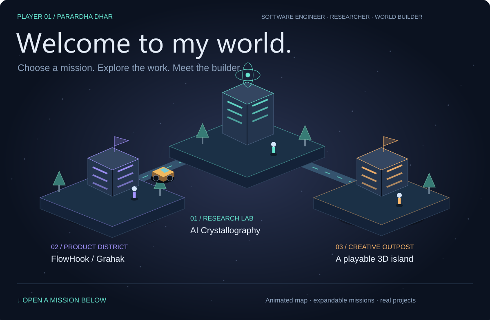
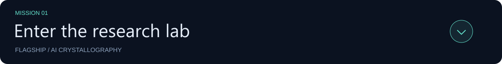
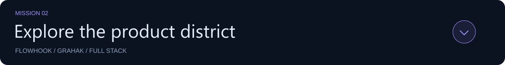
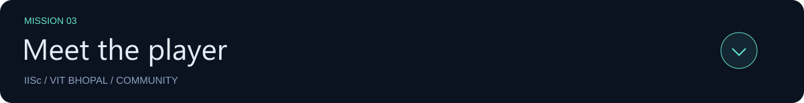
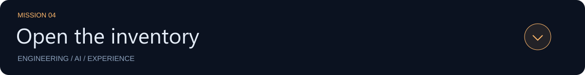

<strong>MISSION 01 · Research lab / AI Crystallography</strong> · click to explore

<strong>MISSION 02 · Product district / FlowHook and Grahak</strong> · click to explore

<strong>MISSION 03 · Meet the player / research, education and community</strong> · click to explore

<strong>MISSION 04 · Inventory / technology toolkit</strong> · click to explore

<a href="https://www.linkedin.com/in/parardhadhar">Connect ↗</a> &nbsp; · &nbsp; <a href="mailto:parardhadhar@gmail.com">Start a conversation ↗</a> &nbsp; · &nbsp; <a href="https://parardha.vercel.app/Parardha_Dhar_SDE_Resume.pdf">Résumé ↗</a>

