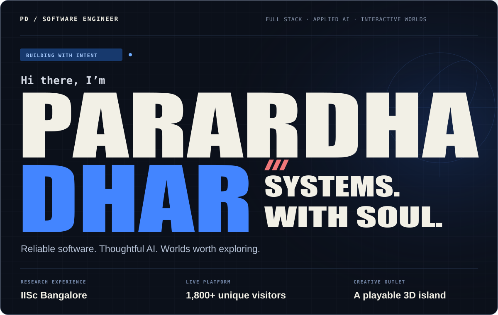
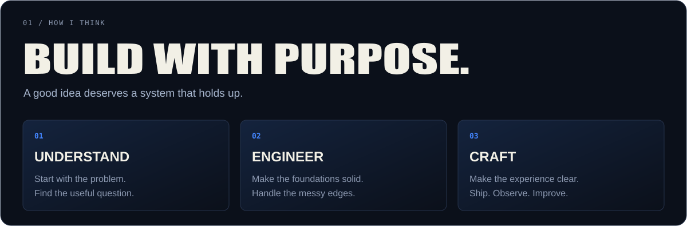
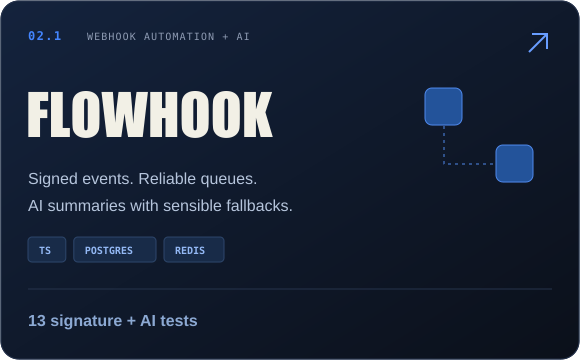
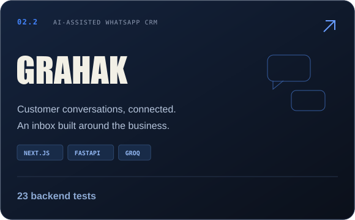
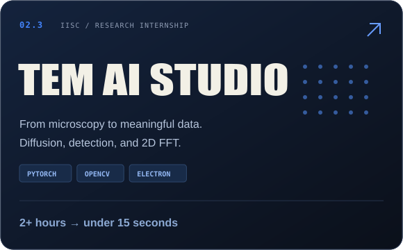
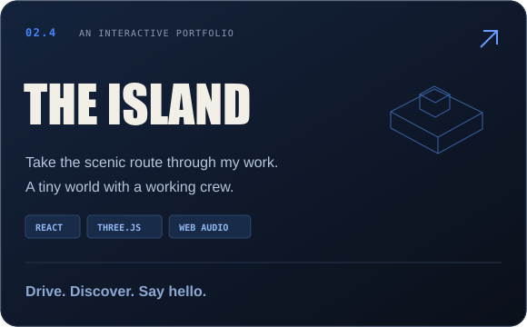
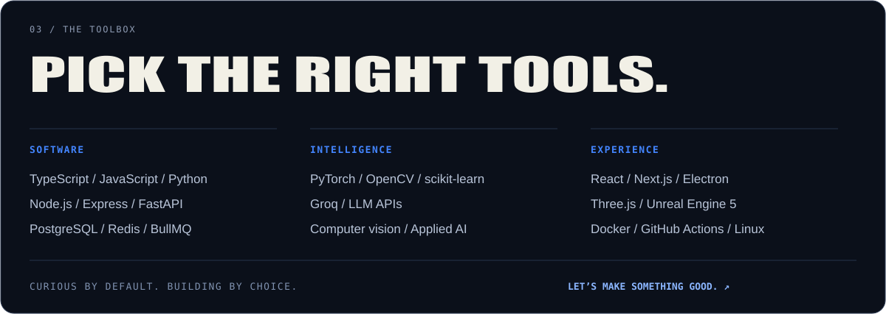

  <a href="https://parardha.vercel.app"><strong>PLAY THE PORTFOLIO ↗</strong></a> &nbsp; / &nbsp;
  <a href="https://www.linkedin.com/in/parardhadhar">LINKEDIN ↗</a> &nbsp; / &nbsp;
  <a href="mailto:parardhadhar@gmail.com">SAY HELLO ↗</a> &nbsp; / &nbsp;
  <a href="https://parardha.vercel.app/Parardha_Dhar_SDE_Resume.pdf">RESUME ↗</a>

### Research roots. Product mindset.

I'm **Parardha**, a Computer Science undergraduate at **VIT Bhopal** and former **Machine Learning Research Intern at IISc Bangalore**. I build backend systems, AI-powered products, and interactive experiences—with as much care for the details as the architecture.

- **Research → real tools.** At IISc, I worked on electron-microscopy analysis with PyTorch, OpenCV, FastAPI, and React/Electron, reducing manual defect calculation from **2+ hours to under 15 seconds per micrograph**.
- **Code → production.** I independently built [VRGC Community Hub](https://vrgc.live), serving **1,800+ unique visitors** and **8,300+ page views**, with a **96/100 Vercel Real Experience Score**.
- **Community → momentum.** Founder & President of the **Virtual Reality and Gaming Club** at VIT Bhopal. Always interested in the space where engineering meets imagination.

 

 

### 02 / Selected work

  <a href="https://grahak-flame.vercel.app">Try Grahak ↗</a> &nbsp; · &nbsp;
  <a href="https://vrgc.live">Visit VRGC ↗</a> &nbsp; · &nbsp;
  <a href="https://github.com/parardhadhar?tab=repositories">Explore all repositories ↗</a>

 

Good systems are built with care. So are good collaborations. <a href="mailto:parardhadhar@gmail.com"><strong>Let’s build something worth using. ↗</strong></a>

